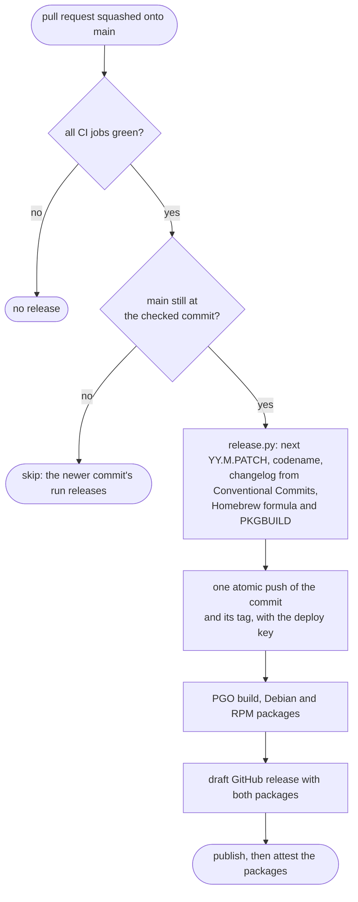

# Contributing to Poopterm

Thanks for helping. Poopterm is a small terminal emulator with big
ambitions for speed and correctness, so contributions are held to a few
firm rules. The full, authoritative rules live in [`AGENTS.md`](AGENTS.md),
shared by human contributors and coding agents alike; this page is the
short version and the practical steps.

By taking part you agree to follow our [Code of Conduct](CODE_OF_CONDUCT.md).

> [!IMPORTANT]
> Security problems are not reported in public issues; see
> [`SECURITY.md`](SECURITY.md).

## Getting set up

1. Install Rust with [rustup](https://rustup.rs). The repository pins a
   **nightly** toolchain in `rust-toolchain.toml` (needed for
   `portable_simd`); rustup picks it up automatically.
2. Install the platform build dependencies:
   - Linux: `pkg-config libx11-dev libxkbcommon-dev libwayland-dev`
     (Debian/Ubuntu names; see the README for Fedora and others).
   - FreeBSD: `pkg install rust pkgconf xorg libX11 libxkbcommon wayland`.
   - macOS: Xcode command line tools.
3. Build and run:

   ```sh
   cargo run --release
   ```

## Before you send a change

Every change must pass the same checks CI runs on Linux, macOS and FreeBSD:

```sh
cargo fmt --check
cargo clippy --all-targets -- -D warnings
cargo test
python3 -m unittest discover -s tests   # release and benchmark scripts
python3 scripts/pr_check.py --base origin/main --title "fix(render): close the arc gap"
```

The last line runs the pull request rules: a Conventional Commits title and
the 3:1 ratio of test lines to code lines described below.

If you touch `#[cfg(target_os = ...)]` code, also run clippy for the other
targets (`aarch64-apple-darwin`, `x86_64-unknown-freebsd`); see
[`AGENTS.md`](AGENTS.md#quick-reference).

## How we work

- **Test first, 3:1.** Every behavior change and bug fix starts with a test
  that fails for the right reason, then the smallest change that makes it
  pass, then cleanup. Each pull request adds at least three lines of tests
  for every line of production code (blank lines and comments do not count;
  changes without code are exempt), and CI fails it otherwise. Meet the
  ratio with tests of real behavior, never padding.
  [`docs/testing.md`](docs/testing.md) explains where tests live and how to
  write emulation tests.
- **Measure performance work.** Benchmark before and after with the tools in
  [`docs/performance.md`](docs/performance.md); changes without a reproducible
  gain are dropped.
- **Check rendering changes with your eyes.** Unit tests cannot see pixels.
  Compare screenshots before and after, and partial redraws against
  `POOPTERM_FULL_REDRAW=1`, as described in
  [`docs/testing.md`](docs/testing.md#visual-checks).
- **No new dependencies.** Features are written in-house from the
  specifications, clean room: never read or copy another implementation's
  source. Existing crates are being replaced over time (see
  [`TODO.md`](TODO.md)), each one tested differentially against the crate it
  replaces.
- **Treat terminal output as hostile.** Anything a program prints can be an
  attack. Keep explicit size limits, never answer queries that leak data,
  and ignore unknown sequences silently.
- **Keep files small and logic pure.** Prefer a new module over growing a
  file past about 400 lines; put encoding, layout and state changes in plain
  functions that tests can call without a window.

[`docs/architecture.md`](docs/architecture.md) is the map of the code;
[`docs/unsafe.md`](docs/unsafe.md) lists every `unsafe` block and why it is
sound.

## Commits and pull request titles

Pull request titles, and the commits on your branch, follow [Conventional Commits 1.0](https://www.conventionalcommits.org/en/v1.0.0/):

```
type(scope): summary in lower case, imperative, no final period

The body explains why the change is needed.
```

Types are `feat`, `fix`, `perf`, `refactor`, `docs`, `test`, `bench`, `build`,
`ci`, `style`, `chore` and `revert`; the scope names the area, usually a
module (`parser`, `vt`, `kitty`, `render`, `pty`, `input`). Keep each commit
small and about one thing. Pull requests are squashed, so the title becomes
the commit on `main` and the changelog is generated from it: it should read
well there.

Do not bump versions or edit `CHANGELOG.md` by hand; CI does that after a
green build on `main`.

## Sending changes

`main` is protected, for maintainers too: every change goes through a
branch and a pull request.

1. Open an issue first for anything larger than a small fix, so we can agree
   on the approach before you spend time on it.
2. Branch from an up-to-date `main` (`fix/short-topic`, after the commit
   type), commit in small steps, and rebase on `main` rather than merging it.
3. Open a pull request with a Conventional Commits title and a body that
   explains why, with benchmark numbers or screenshots where they apply.
   The pull request template carries the checklist, including the
   accessibility checks from [`ACCESSIBILITY.md`](ACCESSIBILITY.md) for
   changes to what users see or do.
4. CI (Linux, macOS, FreeBSD, Alpine, the Debian, Fedora and Arch
   packages, CodeQL) and the pull request
   rules must pass. The pull request is then squashed onto `main`, keeping
   your authorship.

## Releases

You never bump versions: every green commit on `main` is released by CI.



A rerun after a failure resumes the same release without bumping again.
Details are in [AGENTS.md](AGENTS.md#branches-pull-requests-and-commits).

## Reporting bugs

[Open an issue](https://github.com/poopware-laboratories/poopterm/issues/new/choose)
and pick the form that fits: bug report, rendering problem, terminal
compatibility, performance problem, accessibility problem or feature
request. Each form asks for
what that kind of report needs: your Poopterm version (Settings → About, or
`poopterm --version`), OS, display server and shell; steps to reproduce;
for rendering and escape-sequence bugs, the exact bytes that trigger it (for
example captured with `script`) and a screenshot; for performance, numbers.
Questions go to [Discussions](https://github.com/poopware-laboratories/poopterm/discussions).

## License

By contributing, you agree that your contributions are licensed under the
project's license, the [GNU Affero General Public License, version 3 or
later](LICENSE) (`AGPL-3.0-or-later`).
