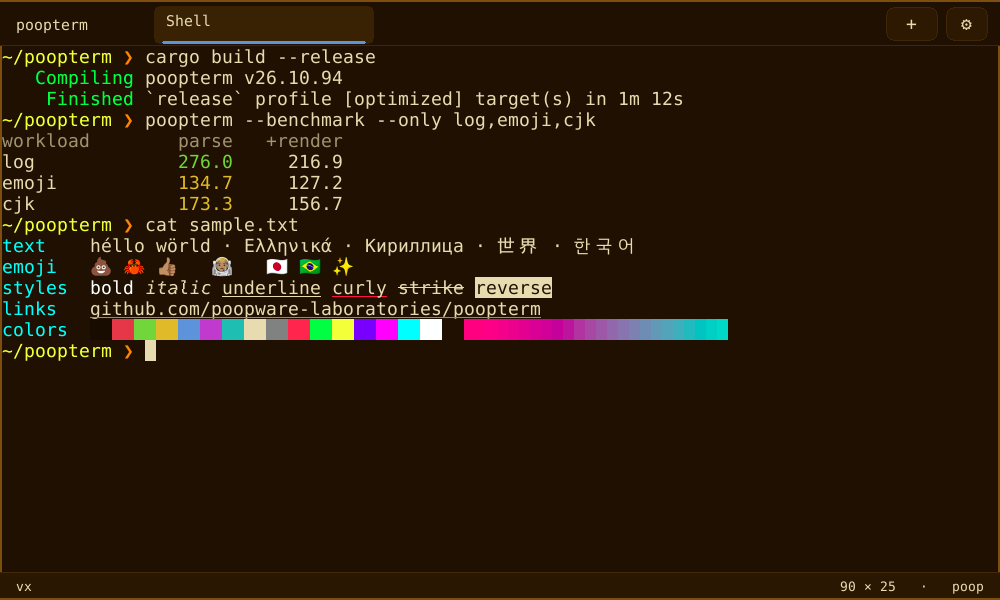

<p align="center">
  
</p>

<h1 align="center">Poopterm 💩</h1>

<p align="center">
  A fast, software-rendered terminal emulator written in Rust, with its own
  escape-sequence parser, font engine and image decoders.
</p>

<p align="center">
  <a href="https://github.com/poopware-laboratories/poopterm/actions/workflows/ci.yml"></a>
  <a href="https://github.com/poopware-laboratories/poopterm/releases/latest"></a>
  <a href="LICENSE"></a>
</p>



Poopterm handles real-world output at 63–248 MB/s end to end (108 MB/s
overall, images included) on a low-power laptop CPU; see
[performance](docs/performance.md). It runs on Linux, macOS and FreeBSD.
Terminal compatibility is growing and is not yet a complete xterm
implementation; see [protocols and compatibility](docs/protocols.md).

## Features

| | |
|---|---|
| **Speed** | A background PTY reader with backpressure, a SIMD tokenizer, an O(columns) row grid with 16-byte cells, redraws paced to the display, and synchronized updates that cost one screen copy. |
| **Text** | 16, 256 and truecolor (semicolon and colon forms), bold, italic, styled and colored underlines, DEC line drawing, wide characters, combining marks, and color emoji with ZWJ sequences, flags and skin tones. |
| **Fonts** | Any installed family or font file, with the bundled DejaVu Sans Mono for Powerline, Nerd Font symbols and a system fallback for missing glyphs. |
| **Images** | Sixel and the kitty graphics protocol, including animation and Unicode placeholders, within explicit memory limits. |
| **Tabs** | Independent shells with activity and bell indicators, renaming, a command palette, and restore of up to 12 tabs and their directories. |
| **Shell integration** | OSC 133 and OSC 7, loaded automatically for zsh, fish and bash: prompt jumps, copy the last command's output, and a notice when a long command finishes. |
| **Input** | The kitty keyboard protocol, SGR mouse reporting, bracketed paste, drag and rectangle selection, and the system clipboard. |
| **Links** | Modifier-click opens HTTP(S), OSC 8 and `file://` links; executables and launchers are copied, never opened. |
| **Search** | Scrollback search with highlighted matches and next/previous navigation. |
| **Look** | 13 built-in themes plus a custom one, PNG/JPEG/WebP wallpapers, padding, compact or vertical tabs, and window opacity on macOS. |
| **Isolation** | On Linux, each tab's shell runs in its own cgroup with a memory cap, so a runaway program cannot starve the terminal or the other tabs. |

## Install

<details>
<summary><b>macOS</b> (Homebrew)</summary>

```sh
brew tap poopware-laboratories/poopterm https://github.com/poopware-laboratories/poopterm.git
brew install poopware-laboratories/poopterm/poopterm
```

Homebrew builds both the `poopterm` command and a `Poopterm.app` bundle in
its managed prefix. Open it, or link it into your Applications folder; the
link follows Homebrew upgrades:

```sh
open "$(brew --prefix)/opt/poopterm/Poopterm.app"
mkdir -p ~/Applications
ln -sfn "$(brew --prefix)/opt/poopterm/Poopterm.app" ~/Applications/Poopterm.app
```

Put Homebrew's `shellenv` in `~/.zprofile` so shells launched from the app
find your tools; see [macOS app bundle](docs/configuration.md#macos-app-bundle).

</details>

<details>
<summary><b>Debian and Ubuntu</b> (APT)</summary>

Packages for 64-bit Debian 12 or newer are published through the
[pooplabs APT repository](https://github.com/poopware-laboratories/pooplabs-apt-repo):

```sh
echo 'deb [trusted=yes] https://poopware-laboratories.github.io/pooplabs-apt-repo/ ./' \
  | sudo tee /etc/apt/sources.list.d/pooplabs.list
sudo apt update
sudo apt install poopterm
```

The repository is unsigned, so `trusted=yes` skips APT's signature check;
install from it only if you trust Poopterm Labs. The package includes the
desktop launcher, icons and terminfo entry.

</details>

<details>
<summary><b>Fedora</b> (RPM)</summary>

Each [release](https://github.com/poopware-laboratories/poopterm/releases)
carries an RPM package for 64-bit Fedora and related distributions, with the
same profile-guided build, launcher, icons and terminfo entry. There is no
DNF repository yet, so updates are installed the same way:

```sh
sudo dnf install ./poopterm-26.10.93-1.x86_64.rpm
```

</details>

<details>
<summary><b>Arch Linux</b> (PKGBUILD)</summary>

The PKGBUILD builds the latest release from source with the nightly
toolchain, which it installs inside the build directory:

```sh
curl -LO https://raw.githubusercontent.com/poopware-laboratories/poopterm/main/packaging/arch/PKGBUILD
makepkg -si
```

</details>

<details>
<summary><b>Linux and FreeBSD</b> from source, system-wide</summary>

`scripts/install.sh` builds with cargo as you, then asks for root (sudo or
doas) only to copy the binary to `/usr/local/bin`, the desktop entry and
icons to `/usr/local/share`, and the terminfo entry to
`/usr/local/share/terminfo`, so every user, desktop and `sudo` finds them:

```sh
scripts/install.sh
scripts/install.sh --uninstall
```

`make && sudo make install` does the same and honors `PREFIX` and `DESTDIR`.

</details>

Release packages carry a signed build provenance attestation, which proves
that the release workflow built them from the tagged commit:

```sh
gh attestation verify poopterm_26.10.93-1_amd64.deb --repo poopware-laboratories/poopterm
```

## Build from source

Poopterm needs **nightly Rust** for `portable_simd`; the included
`rust-toolchain.toml` selects it when Rust comes from rustup.

```sh
cargo run --release          # build and launch
cargo build --release        # binary: target/release/poopterm
```

<details>
<summary>Build dependencies per platform</summary>

| Platform | Command |
|----------|---------|
| Debian, Ubuntu | `sudo apt install build-essential pkg-config libx11-dev libxkbcommon-dev libwayland-dev` |
| Fedora | `sudo dnf install gcc pkgconf-pkg-config libX11-devel libxkbcommon-devel wayland-devel` |
| Arch Linux | `sudo pacman -S base-devel libx11 libxkbcommon wayland` |
| macOS | `xcode-select --install` |
| FreeBSD | `pkg install rust pkgconf xorg libX11 libxkbcommon wayland` |

</details>

Released packages are profile-guided builds. `make pgo` trains on the
built-in benchmark (about 5% faster than a plain release build, 13% on
interactive output), `make pgo-use` trains further on your own sessions,
`make bolt` adds BOLT on Linux (about 3% more), and `make pgo-install`
installs what releases ship. See
[profile-guided optimization](docs/performance.md#profile-guided-optimization).

## Configuration

Open **Settings** with the gear button in the tab bar, or edit
`~/.config/poopterm/config.toml` (`~/Library/Application Support/poopterm/config.toml`
on macOS). Settings edits the same file and keeps your comments and unknown
keys.

```toml
theme = "catppuccin-mocha"
font_family = "JetBrains Mono"
font_size = 14          # points, 10–32
scrollback_lines = 5000
padding = 4
```

Every key, the themes, fonts, environment variables, shell integration,
session restore and terminfo are described in
[configuration](docs/configuration.md).

## Keyboard shortcuts

| Action | macOS | Linux and FreeBSD |
|--------|-------|-------------------|
| New tab | Cmd+T | Ctrl+Shift+N |
| Close tab | Cmd+W | Ctrl+Shift+W |
| Next / previous tab | Ctrl+Tab / Ctrl+Shift+Tab | Ctrl+Tab / Ctrl+Shift+Tab |
| Go to tab 1–9 | Cmd+1–9 | Ctrl+1–9 |
| Copy / paste | Cmd+C / Cmd+V | Ctrl+Shift+C / Ctrl+Shift+V |
| Search scrollback | Cmd+F | Ctrl+Shift+F |
| Previous / next prompt | Cmd+Up / Cmd+Down | Ctrl+Shift+Up / Ctrl+Shift+Down |
| Zoom in / out / reset | Cmd+= / Cmd+- / Cmd+0 | Ctrl+= / Ctrl+- / Ctrl+0 |
| Command palette | Ctrl+Shift+P | Ctrl+Shift+P |
| Cycle themes | Ctrl+Shift+T | Ctrl+Shift+T |
| Open link, copy path | Cmd-click | Ctrl-click |

In search, **Enter** and **Shift+Enter** move to the next and previous
match, and **Esc** closes it. Search is case-insensitive for ASCII and finds
up to 10,000 matches. Zoom (6 to 72 points) lasts for the session; Settings
keeps the saved size. Prompt jumps need
[shell integration](docs/configuration.md#shell-integration). The mouse
wheel scrolls back unless the running program has enabled mouse reporting;
hold **Alt** while dragging to select a rectangle.

Change bindings in **Settings → Shortcuts** (click a binding and press a new
chord) or with the `shortcut_*` keys described in
[configuration](docs/configuration.md#shortcuts). On Linux, the clipboard
needs `wl-clipboard` on Wayland or `xclip`/`xsel` on X11.

## Protocols

Poopterm implements each sequence as its specification defines it, queries
and replies included, and ignores unknown ones silently. Highlights:
synchronized output (`?2026`), OSC 133 semantic prompts, OSC 7 working
directories, OSC 8 hyperlinks, OSC 52 clipboard writes (reads are refused),
the kitty keyboard protocol, styled underlines, Sixel and the kitty graphics
protocol. Details and limits are in [protocols](docs/protocols.md).

## Accessibility

[`ACCESSIBILITY.md`](ACCESSIBILITY.md) describes what works today (keyboard
shortcuts for every action, font sizes up to 32 points (72 with zoom), custom
high-contrast colors, no blinking), the known gaps such as screen reader
support, and how to report an accessibility problem.

## Development

```sh
cargo test
cargo clippy --all-targets -- -D warnings
cargo fmt --check
```

Development is test-driven. Start with [`AGENTS.md`](AGENTS.md) (for humans
and AI coding agents alike), then read about the
[architecture](docs/architecture.md), [testing](docs/testing.md),
[performance](docs/performance.md) and [unsafe code](docs/unsafe.md). CI
checks Linux, macOS and a real FreeBSD VM.

Want to help? Read [CONTRIBUTING.md](CONTRIBUTING.md) and the
[Code of Conduct](CODE_OF_CONDUCT.md). Report security problems privately as
described in [SECURITY.md](SECURITY.md), never in a public issue.

Releases are numbered `YY.M.PATCH` with a random codename per month. CI
releases every green commit on `main`: it bumps the version, updates the
changelog and Homebrew formula, tags, and publishes the Debian and RPM
packages. Changes reach `main` only through squashed pull requests; see
[AGENTS.md](AGENTS.md#branches-pull-requests-and-commits).

## License

Poopterm is free software: you can redistribute it and/or modify it under the
terms of the [GNU Affero General Public License](LICENSE) as published by the
Free Software Foundation, either version 3 of the License, or (at your option)
any later version. It is distributed in the hope that it will be useful, but
WITHOUT ANY WARRANTY; without even the implied warranty of MERCHANTABILITY or
FITNESS FOR A PARTICULAR PURPOSE. Earlier releases were published under the
MIT License.

Copyright © 2026 poopware-labs and contributors. Third-party palette notices
(Catppuccin, Nord, and Rosé Pine) are in
[THIRD_PARTY_NOTICES](THIRD_PARTY_NOTICES).

Poopterm bundles DejaVu Sans Mono for Powerline as `assets/font.ttf`, under
the Bitstream Vera license with public-domain changes; see the
[DejaVu font license](https://dejavu-fonts.github.io/License.html).
